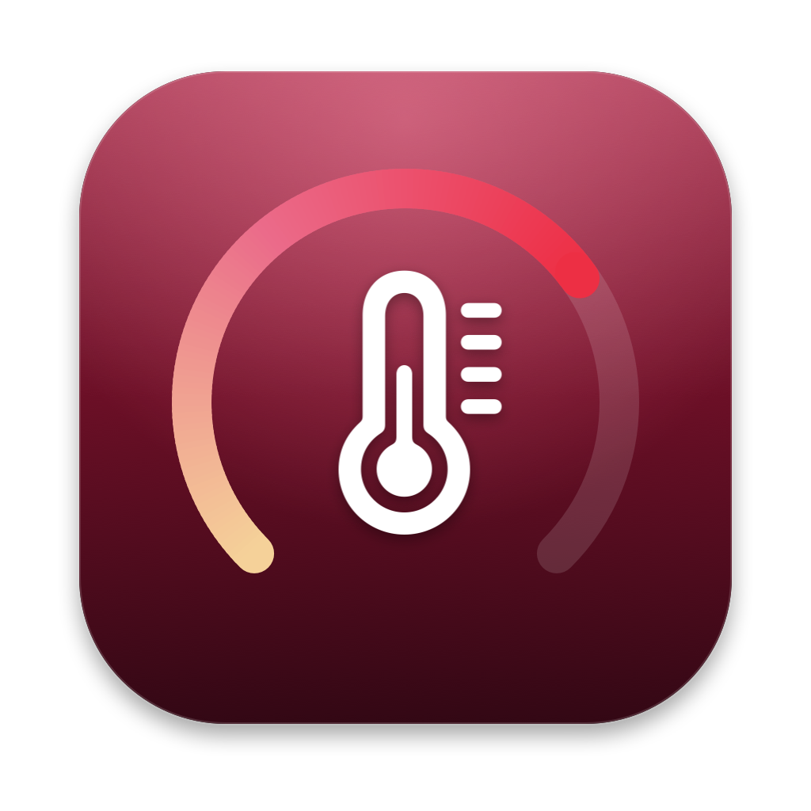
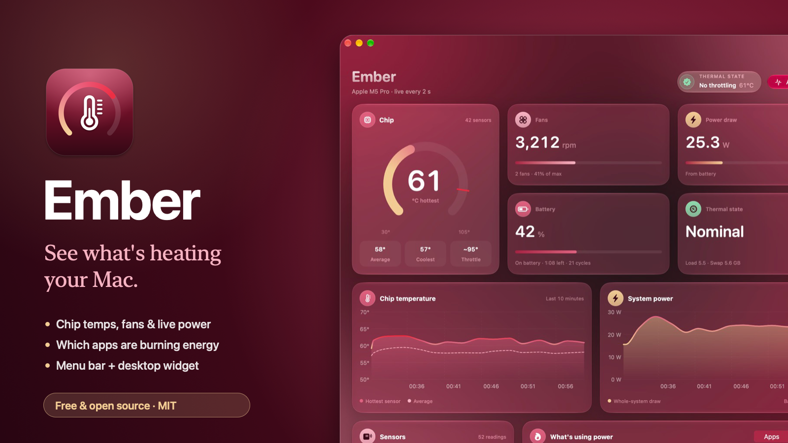
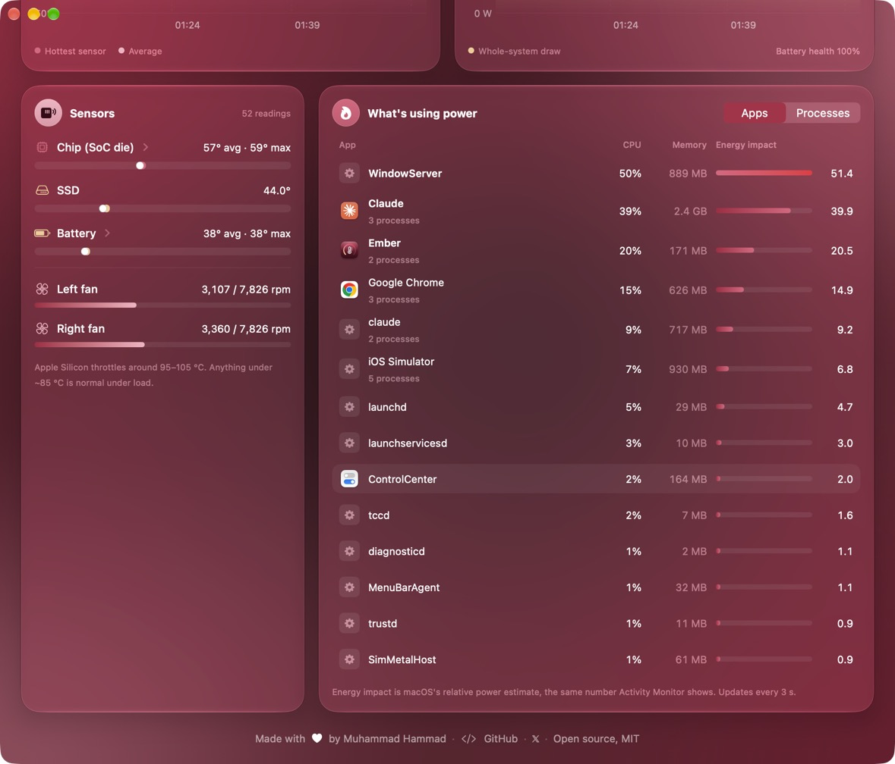

<p align="center">
  
</p>

<h1 align="center">Ember</h1>

<p align="center">
  <b>See what's heating your Mac.</b><br>
  Chip temperatures, fan speeds, live power draw and the apps burning the most energy,<br>
  in a Liquid Glass dashboard, a menu bar extra and a desktop widget.
</p>

<p align="center">
  
  
  
  
</p>

<p align="center">
  
</p>

## Why

My MacBook was running hot and I wanted to know *why*. Activity Monitor tells you which process is busy, but not how hot the chip is, how hard the fans are working or how many watts the whole machine is pulling. Ember puts all of that on one screen, and it stays light while it does it.

## Features

- **Chip temperature**: the hottest of the 40+ die sensors on a gauge, with the average, the coolest and the point where Apple Silicon starts to throttle.
- **Fans**: live rpm per fan and how close each is to its maximum.
- **Live power draw**: whole-system watts from the SMC, updated every second, with a 10-minute chart.
- **What's using power**: apps ranked by macOS Energy Impact (the same number Activity Monitor shows), with helper processes rolled up into their parent app. Switch to per-process view any time.
- **Battery**: charge, time remaining, cycle count and health.
- **Thermal state**: whether macOS is throttling, straight from `ProcessInfo`.
- **Menu bar extra**: the hottest sensor in your menu bar, with a quick panel showing the top energy users.
- **Desktop widget**: small and medium sizes with the gauge, fans, power, battery and a 30-minute temperature trend.
- **Burgundy Liquid Glass UI** whose ambient glow shifts from deep wine to crimson as the chip heats up.

<p align="center">
  
</p>

## Light on your Mac

A monitor that heats up your Mac defeats the point, so Ember is careful:

| State | Ember CPU |
| --- | --- |
| Dashboard open, app list on screen | ~1.6% app + ~1.7% for the process sampler |
| Dashboard open, app list scrolled away | ~1.6% |
| Window closed, or you've stepped away | well under 1% |
| Desktop widget | ~0%: it redraws every 5 minutes from a 200-byte snapshot |

- Process sampling (a single long-running `top`, every 5 s like Activity Monitor) only runs while a process list is actually on screen.
- After a minute without keyboard or mouse input, Ember stops sampling processes and reads sensors every 10 s.
- Sensors that never report a valid temperature are dropped at launch, which cut each read from ~80 ms to ~30 ms.
- When nothing is visible, SwiftUI doesn't re-render anything; UI updates and hover effects pause while you scroll.

Measured on an M5 Pro MacBook Pro.

## Install

Requirements: an Apple Silicon Mac on macOS 26 or later, with Xcode 26 (or its command line tools) installed.

```bash
git clone https://github.com/hammad1201/ember-mac.git
cd ember-mac
./build.sh --install
open ~/Applications/Ember.app
```

`build.sh` compiles everything with `swiftc` (no Xcode project needed), draws the app icon and signs the bundle.

**About the widget:** macOS only loads widgets signed by a developer identity, and the app shares data with the widget through a team-scoped App Group. `build.sh` picks the first *Apple Development* certificate in your keychain automatically (signing into Xcode with your Apple ID creates one). Without one, Ember is ad-hoc signed and builds without the widget; everything else works the same.

To add the widget, right-click the desktop → **Edit Widgets** → search for **Ember**. Turn on **Open at login** in the menu bar panel so the widget keeps updating.

## How it works

Everything is read without root or a helper tool:

| Data | Source |
| --- | --- |
| Temperatures | IOKit HID event system (`IOHIDEventSystemClient`), the same sensors `powermetrics` uses |
| Fan speeds, system power | The SMC through the `AppleSMC` user client (`F0Ac`, `F0Mx`, `PSTR`) |
| Battery | `AppleSmartBattery` in the IORegistry |
| Per-app energy | One long-running `top -l 0 -o power`, parsed as it streams |
| Throttling | `ProcessInfo.thermalState` |

Nothing leaves your Mac: Ember makes no network requests.

## Project layout

```
Sources/          App: SwiftUI views, the monitor, sensor/SMC/power readers
Sources/Shared/   Theme and widget snapshot, shared with the widget
Widget/           WidgetKit extension
Scripts/          Icon and social card renderers
build.sh          Build, sign, bundle the widget, optionally install
```

## Contributing

Issues and pull requests are welcome, especially sensor names for other Apple Silicon chips and Intel Macs.

## License

[MIT](LICENSE)

---

<p align="center">
  Made with ♥ by <a href="https://github.com/hammad1201">Muhammad Hammad</a> · <a href="https://x.com/hammad_1201">@hammad_1201</a>
</p>
